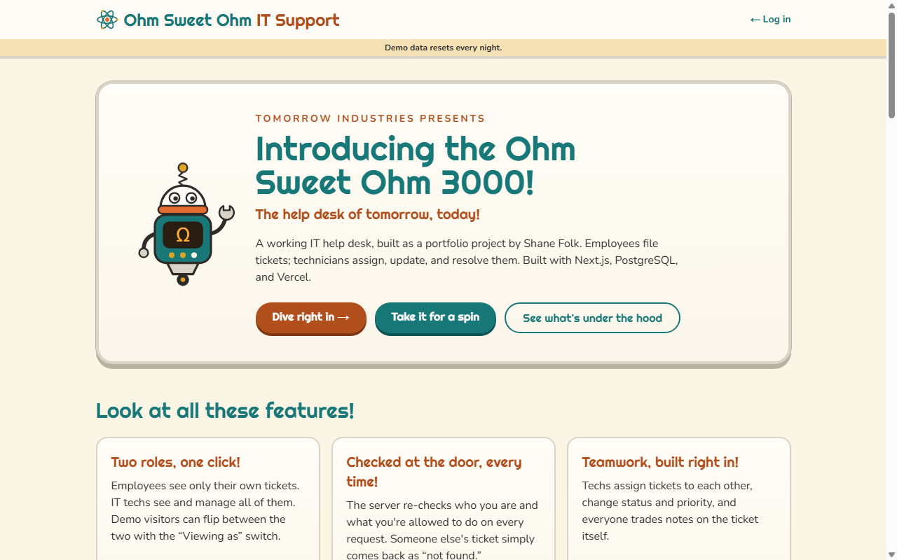
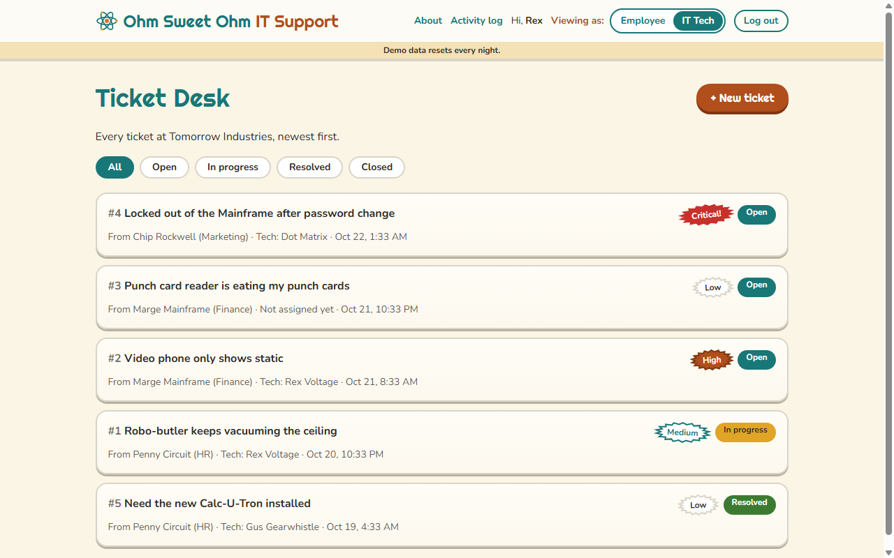
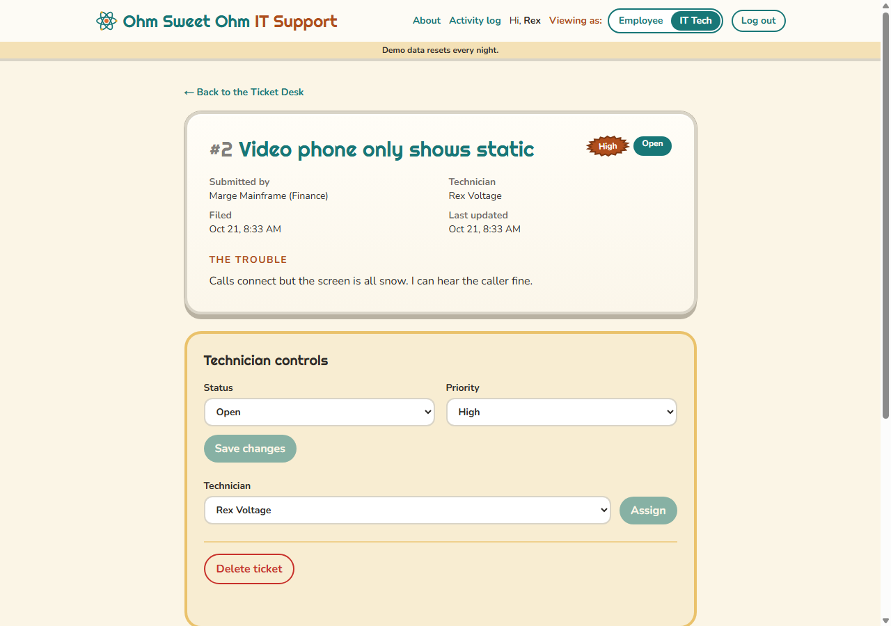
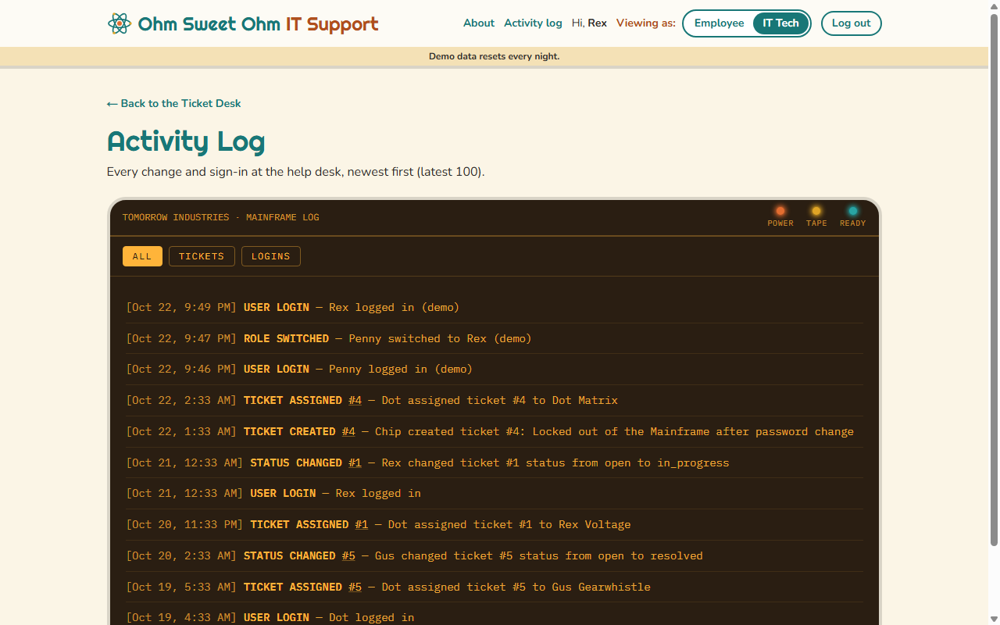
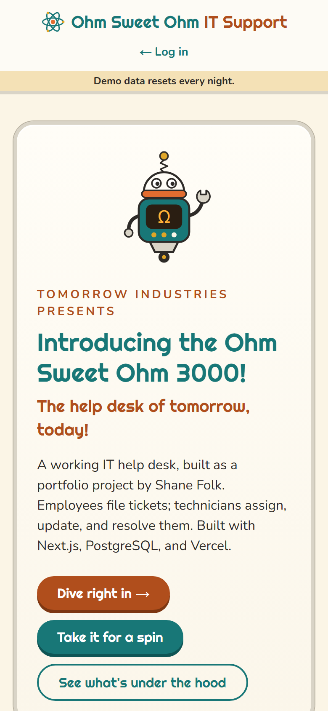
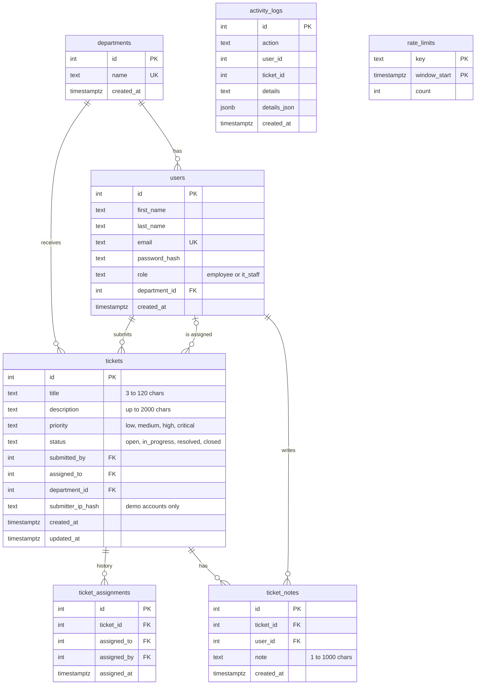

# Ohm Sweet Ohm IT Support

**The help desk of tomorrow, today!** A full-stack IT help desk for the fictional Tomorrow Industries, styled like a 1950s appliance ad. Employees file tickets; IT technicians assign, update, and resolve them.

**Live demo: [ohm-sweet-ohm-five.vercel.app](https://ohm-sweet-ohm-five.vercel.app)** · Built by [Shane Folk](https://shanefolk.com)



## Try it in two minutes

No sign-up needed. On the home page or the login page, click a demo button:

| Demo account | Role | What you can do |
| --- | --- | --- |
| **Penny Circuit** (HR) | Employee | File tickets, see only your own, add notes |
| **Rex Voltage** (IT) | IT Tech | See every ticket, assign techs, change status and priority, delete, read the activity log |

Once you're logged in as a demo account, the **Viewing as** switch in the header flips between the two roles. Demo data resets every night.

## Screenshots

| Ticket Desk (IT view) | Ticket detail with technician controls |
| --- | --- |
|  |  |

| Activity log | On a phone |
| --- | --- |
|  |  |

## Tech stack

| Piece | Choice |
| --- | --- |
| Framework | Next.js 16 (App Router, TypeScript): pages and API routes in one app |
| Database | PostgreSQL on Neon, queried with plain parameterized SQL (no ORM) |
| Hosting | Vercel, with a nightly Vercel Cron job that resets the demo |
| Sign-in | Signed JWT (`jose`) in an httpOnly cookie; passwords hashed with `bcryptjs` |
| Validation | Zod schemas on every request body |
| Styling | Tailwind CSS v4 with a custom "Atomic Age Appliance" theme |

## Database

Seven PostgreSQL tables. Lengths and allowed values are enforced by the database as well as the app.



`activity_logs` has no foreign keys on purpose, so a ticket's history survives after the ticket is deleted. `rate_limits` holds one row per action per minute. The full schema is in [`db/schema.sql`](db/schema.sql).

## How it stays safe

Every API request passes these checks in order:

1. **`proxy.ts`** sends logged-out visitors to the login page. This is a convenience for pages, not the security wall.
2. **Session and role:** the API route verifies the signed cookie and the role. Failures get 401 or 403.
3. **Rate limit:** too many requests this minute get 429 with a `Retry-After` header.
4. **Zod validation:** a body with the wrong shape or size gets 400 with the reason.
5. **Ownership:** an employee asking for someone else's ticket gets 404, so other people's tickets stay invisible.
6. **PostgreSQL:** only parameterized SQL (`$1, $2`), so typed text can never become a command.

Other protections:

- "Who did this" values (ticket owner, note author, log entry) always come from the session, never from the request body.
- Password hashes never leave the server, and login errors never say whether an email exists.
- Security headers block framing (clickjacking) and content-type guessing.
- The nightly reset route only answers to a secret held by Vercel, compared in constant time.
- Demo visitors are told apart by a one-way hash of their IP, never the IP itself.
- Failed logins are never written to the activity log, because demo visitors can read it.

### Spam limits

| Action | Limit | Counted |
| --- | --- | --- |
| Log in (password or demo) | 5 per minute each | per IP address |
| Create a ticket | 5 per minute | per user |
| Add a note | 10 per minute | per user |
| Any other change | 30 per minute | per user |
| Open tickets | 10 at a time | per user (per visitor on demo accounts) |
| Notes | 20 | per ticket |
| Whole demo | 300 tickets, 1,000 notes | until the nightly reset |

## Run it locally

You'll need Node.js 20+ and a free [Neon](https://neon.tech) Postgres database.

1. **Install:**
   ```bash
   git clone https://github.com/ShaneFolk/ohm-sweet-ohm.git
   cd ohm-sweet-ohm
   npm install
   ```
2. **Settings:** copy `.env.example` to `.env.local` and fill in the four values. For the two secrets, you can generate random strings with:
   ```bash
   node -e "console.log(require('crypto').randomBytes(32).toString('hex'))"
   ```
3. **Database:** open your Neon project's SQL Editor and run [`db/schema.sql`](db/schema.sql).
4. **Demo data:**
   ```bash
   npm run seed
   ```
5. **Start:**
   ```bash
   npm run dev
   ```
   Open http://localhost:3000. Every seeded account uses your `DEMO_PASSWORD`, or you can use the demo buttons.

To deploy, import the repo into Vercel and add the same four environment variables. `vercel.json` schedules the nightly reset at 08:00 UTC.

## Project layout

```text
app/
  page.tsx            Home page (brochure, demo tour, spec sheet)
  _landing/           Home page parts, including the database diagram
  login/              Login page
  tickets/            Ticket list, new ticket form, ticket detail
  admin/logs/         Activity log (IT only)
  api/                API routes: auth, tickets, notes, assign, activity logs, cron reset
  components/         Header, badges, robot mascot, atom, loading and empty states
lib/                  Server code: auth, database, tickets, notes, rate limits, caps, seed
db/schema.sql         The database schema
proxy.ts              Page redirects for logged-out visitors and employees
```

## API

| Method and route | Who | What it does |
| --- | --- | --- |
| `POST /api/auth/login` | Anyone | Log in with email and password |
| `POST /api/auth/demo-login` | Anyone | Log in as a demo account |
| `POST /api/auth/demo-switch` | Demo accounts | Flip between Penny and Rex |
| `POST /api/auth/logout` | Logged in | Log out |
| `GET /api/auth/me` | Logged in | Who am I |
| `GET /api/tickets` | Logged in | Your tickets (IT: all tickets) |
| `POST /api/tickets` | Logged in | File a ticket |
| `GET /api/tickets/:id` | Owner or IT | One ticket |
| `PATCH /api/tickets/:id` | IT | Change status or priority |
| `DELETE /api/tickets/:id` | IT | Delete a ticket |
| `POST /api/tickets/:id/assign` | IT | Assign a technician |
| `GET, POST /api/tickets/:id/notes` | Owner or IT | Read or add notes |
| `GET /api/activity-logs` | IT | The activity log (`?filter=all`, `tickets` or `logins`) |
| `GET /api/departments` | Logged in | Department list |
| `GET /api/cron/reset` | Vercel Cron | Nightly demo reset |
